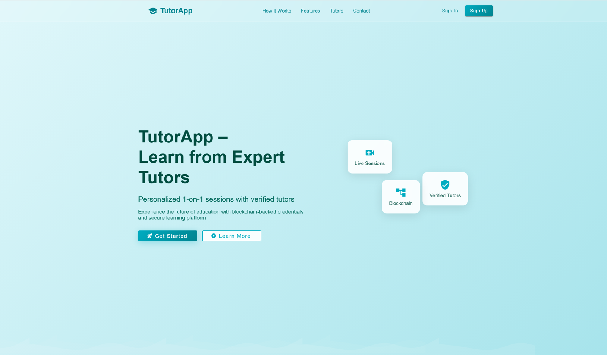

# Blockchain-Integrated Tutor App

Angular tutoring platform that connects students, tutors and teachers, with an admin panel and MetaMask (Web3) wallet integration. Built as a full-stack web project with an Angular 21 frontend, Firebase (Auth and Firestore) and a Node.js / Express API.

## Screenshots

## Overview
Students find tutors, view their profiles, book sessions and pay. Tutors manage their profile and availability. Teachers grade student work. Admins manage users and platform activity. Every area is protected by role-based route guards.

## Features
**Authentication and roles**
- Register and log in with email and password (Firebase Auth)
- Four roles: Student, Tutor, Teacher, Admin, each with its own dashboard
- Route guards by role (`student`, `tutor`, `admin`) and an auth interceptor that attaches the user's token to API calls
- Separate admin login and admin panel

**Student**
- Find tutors and open full tutor profiles
- Book sessions through the tutor's availability
- Payment dialog and session history
- Enrollments tracked with progress

**Tutor**
- Tutor profile and dashboard
- Availability dialog for setting open time slots

**Teacher**
- Teacher dashboard and grading screen

**Admin**
- Admin dashboard and panel for managing users and viewing activity
- Firebase seeder tools to load sample data

**Other**
- Landing page with contact form (messages stored in Firestore)
- MetaMask wallet connection through Web3.js (connect wallet, read account)

## Tech stack
| Layer | Technology |
|---|---|
| Frontend | Angular 21, TypeScript, SCSS, Angular Material, ngx-toastr |
| Backend services | Firebase Auth, Cloud Firestore (`@angular/fire`) |
| API server | Node.js, Express, JWT, rate limiting, Nodemailer (`server.js`) |
| Blockchain | Web3.js with MetaMask |

## Project structure
